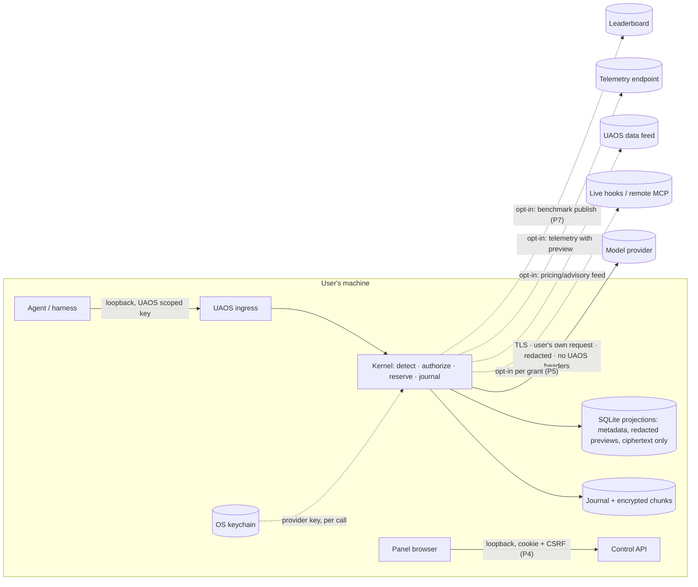

# Privacy data flow — v0 (P0)

Red line 1: data stays local; external contact is opt-in, minimized and transparent. This page
lists **every** flow that leaves the machine. A flow not listed here is a bug.

## External contacts

| Flow | Default | Data sent | Minimization |
|---|---|---|---|
| Model provider | on (it is the user's purpose) | the user's request after redaction | no UAOS-identifying or tracing headers; connections warmed only after the first request in a session |
| Live hooks / remote MCP | off | what the grant allows | per-grant domain allowlist, TTL, sanitization |
| Pricing / advisory feed | off (manual `uaos pricing update`) | none beyond the HTTP request | signed packages; no identifiers |
| Update check | off | none | — |
| Telemetry | off | published schema only | `uaos telemetry preview` shows the exact payload |
| Benchmark publish | off | sanitized/synthetic results | opt-in per publication |
| NTP / provider health (doctor) | off | — | only with `uaos doctor --online` |

## Data at rest

- Content (prompts, outputs, tool payloads) is stored only as encrypted chunks with per-chunk
  keys; deleting means crypto-shredding plus pocket-key rotation.
- SQLite never holds plaintext content (enforced by type from P1).
- Pocket keys and provider API keys live in the OS keychain, never in the data directory
  (ADR-0007). What "shredded" guarantees depends on that backend and is stated in ADR-0007 §4.
- The data directory lives in the OS's local (non-roaming) application-data location;
  `uaos doctor` warns when it sits inside a cloud-sync folder (OneDrive, iCloud, Dropbox).
- Limit stated honestly: OS-level backups and keychain backups are outside UAOS's control.

## Privacy impact assessments required

C-16, C-17, C-35, C-43, C-44, C-56, C-59, C-61 — each before its phase gate.
