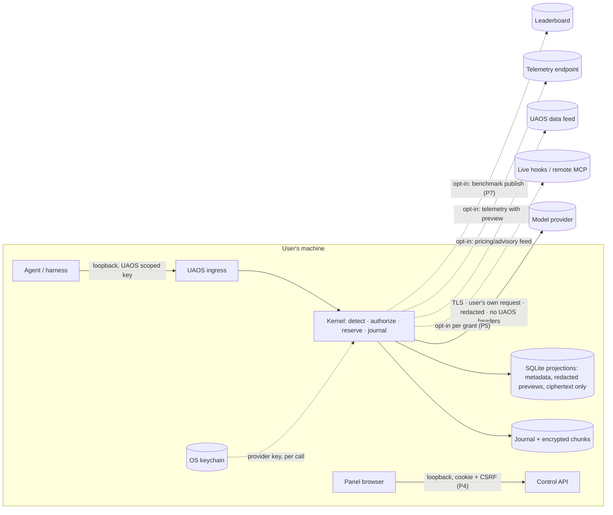

# Privacy data flow — v1 (P3)

Red line 1: data stays local; external contact is opt-in, minimized and transparent. This page
lists **every** flow that leaves the machine. A flow not listed here is a bug.

## External contacts

| Flow | Default | Data sent | Minimization |
|---|---|---|---|
| Model provider | on (it is the user's purpose) | the user's request after redaction | no UAOS-identifying or tracing headers; connections warmed only after the first request in a session |
| Live hooks / remote MCP | off | what the grant allows | per-grant domain allowlist, TTL, sanitization |
| Pricing / advisory feed | off (manual `uaos pricing update`) | none beyond the HTTP request | signed packages; no identifiers |
| Update check | off | none | — |
| Telemetry | off | published schema only | `uaos telemetry preview` shows the exact payload |
| Benchmark publish | off | sanitized/synthetic results | opt-in per publication |
| NTP / provider health (doctor) | off | — | only with `uaos doctor --online` |
| OS certificate checks (OCSP, CRL, AIA) | triggered by the operating system's certificate verifier when UAOS opens TLS to the user's provider (ADR-0013 §5) | the certificate's serial or issuer URL, to the certificate authority named in the provider's certificate; nothing from the request | UAOS uses the platform verifier and does not add these fetches itself; they are classified in the zero-egress capture (I-14) and listed here so they are never a surprise |

### What the agent's own client sends through UAOS

UAOS forwards the client's request after redaction. It does not add data, and it does not
remove fields a provider needs. Some clients put metadata about the machine into every request,
and that metadata reaches the provider as part of the user's own request. Recorded from the
Claude Code capture (`docs/research/beachhead-facts.md`):
- **CAP-3:** eight `x-stainless-*` headers, describing the SDK, the language runtime, the OS and
  the architecture.
- **CAP-8:** a `safeguards` body field carrying environment metadata.
- **CAP-10:** organization and workspace identifiers in the provider's responses.

UAOS treats these as the client's data: it journals them like any other request content
(encrypted chunks), never adds to them, and does not strip them by default, because stripping
could change the provider's behaviour for the user. Whether to offer an opt-in minimizing
transform is an open question for the dialect modules (WP3.4). It is not decided here.

## Data at rest

- Content (prompts, outputs, tool payloads) is stored only as encrypted chunks with per-chunk
  keys; deleting means crypto-shredding plus pocket-key rotation.
- SQLite never holds plaintext content (enforced by type from P1).
- Pocket keys and provider API keys live in the OS keychain, never in the data directory
  (ADR-0007). What "shredded" guarantees depends on that backend and is stated in ADR-0007 §4.
- The data directory lives in the OS's local (non-roaming) application-data location;
  `uaos doctor` warns when it sits inside a cloud-sync folder (OneDrive, iCloud, Dropbox).
- Limit stated honestly: OS-level backups and keychain backups are outside UAOS's control.

## Inside the process (P3 design, not yet built)

This section describes the design being built in P3. It becomes a statement about UAOS only when
its gates (`kernel-tokens`, `empty-kernel`, `surface`) are active.

- **Modules see a redacted view.** In-process modules receive the request with detected secrets
  already replaced by placeholders, plus metadata. At RC-1 no module can obtain the raw view.
- **Modules cannot contact anything.** A module has no network, file or process handle. Any
  external effect it wants is a child Operation that passes the same policy, budget, journal,
  redaction and door as a user request, and appears in this table's flows only through them
  (ADR-0010 Revision 1).
- **Panic messages are never printed.** A panic message could carry request content, so the
  binary's panic hook records the location and a code only.

## Privacy impact assessments required

C-16, C-17, C-35, C-43, C-44, C-56, C-59, C-61 — each before its phase gate.
